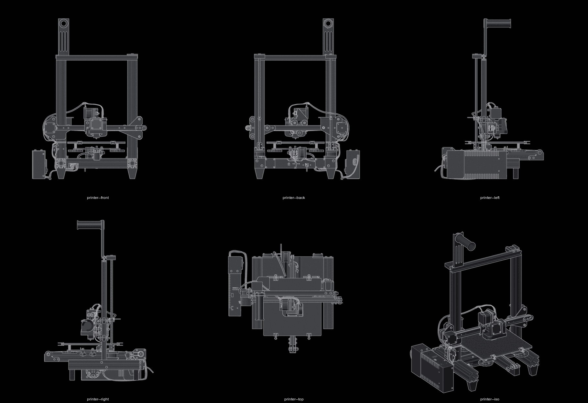
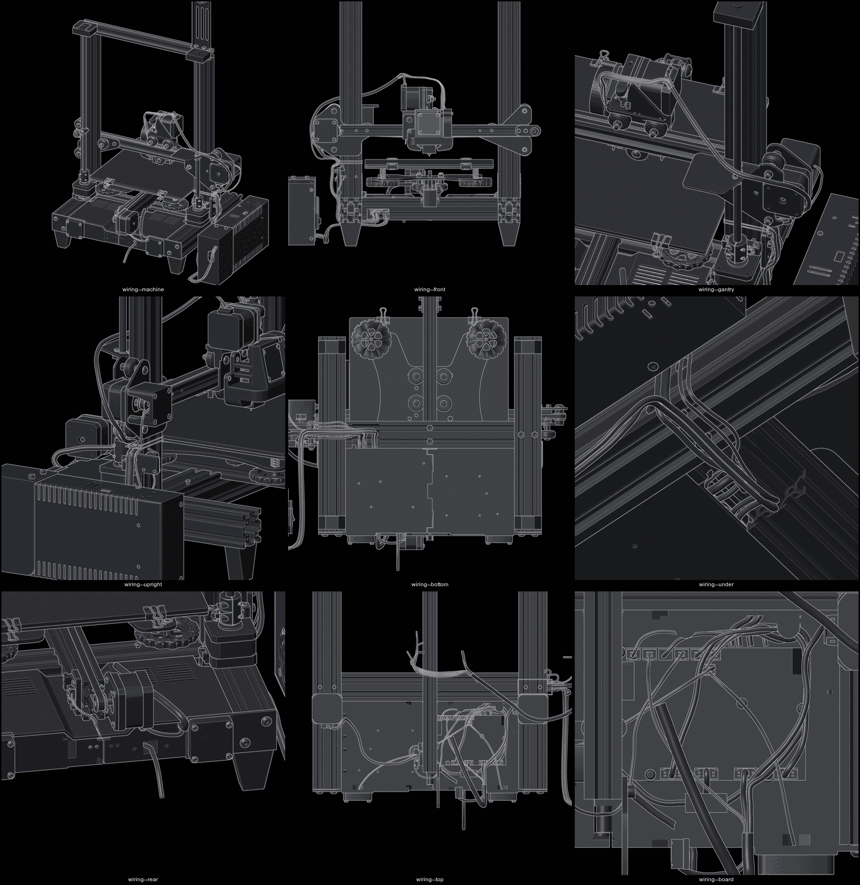

solder

ender 3 | heavily modified | klipper in docker on separate host | printer is dumb usb device

model and previews all black | real colours kept as secondary materials in the blend

hardware
v4.2.7 board | stm32f103 | tmc2225 soldered down | 4 drivers
direct drive | stock extruder on x gantry | printed bracket
dual z | one driver | parallel splitter | half current each
ender-3 v3 se hotend | stock ptfe-lined heatbreak | 260 °C ceiling | 0.4 nozzle | satsana duct | 5015 blower
cms-350-24 psu | 24v 350w | off the frame, on its long edge on the floor, left side
235x235x200 | cartesian | not corexy
printed riser feet | four | frame 43.1 off the floor

docs
- hardware/ overview | bom | pin map | printed mods | probe | hotend | model
- hardware/model.md blender scene | park pose | part positions | wiring runs | screws | colours | previews in hardware/model/
- setup/ firmware | configuration | calibration | power-loss recovery
- slicer/ orca presets | settings that matter
- log/ what is proven | what bites | resume method
- config/ live cfg copies
- backlog.md what to add next | what is deferred
- references.md vendor source | upstream links
- resume-at.py measured part height to resume layer and byte
- model-preview.py blender scene and reference STLs to preview tiles

state
prints | 18h job resumed mid-print from a measured height | completed 11.94h
extruder fault was motor wiring | not driver | not motor
one doubled layer at the resume joint | deliberate | bonds instead of floating
owed `max_temp` 300 against a 260 °C hotend | z endstop for the new nozzle height
duct outlet sits on the heater block, not at the nozzle | weak part cooling | duct touches hot metal
owed pid | pressure advance | nozzle offset | bed_mesh bounds | input_shaper
rotation_distance 32.111 | measured 2026-09-29 on the fitted extruder
one of two case fans dead | broken splice
spool tracked in spoolman | bound to klipper | usage reported per print
filament never dried | owed since bring-up
model owes psu location | cut duct mesh | measured lead screw top mount | `hardware/model.md`

gotchas
g28 parks at bed centre | safe_z_home active | never g28 z with a part on the bed
4.2.7 swaps step/dir pairwise vs 4.2.2 | shipped ender3 cfgs are all 4.2.2 maps
emergency_stop does not depower motor ports | vmot stays live | power off at psu
one controllable fan output | pa0 | rest hardwired 24v always-on
set_velocity_limit not clamped to config | persists until firmware_restart
plr declares z only when z is unhomed | a homed z is the real datum, a saved one is stale
usb replug recovers itself | host `/dev` bound live | udev hook `FIRMWARE_RESTART`s | `devices/knave/README.md`
pressure_advance comes from the filament preset | printer.cfg value never applies
3mf carries its own process settings | they override the preset
