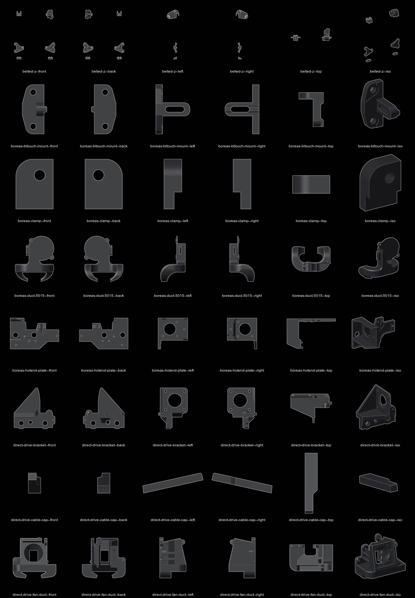
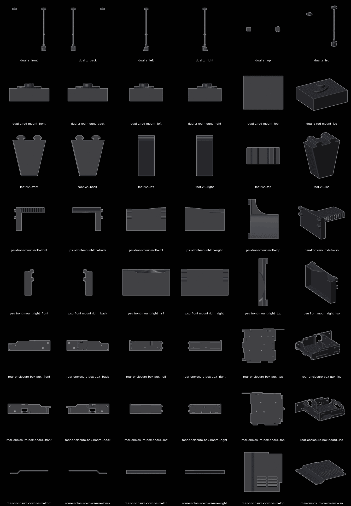
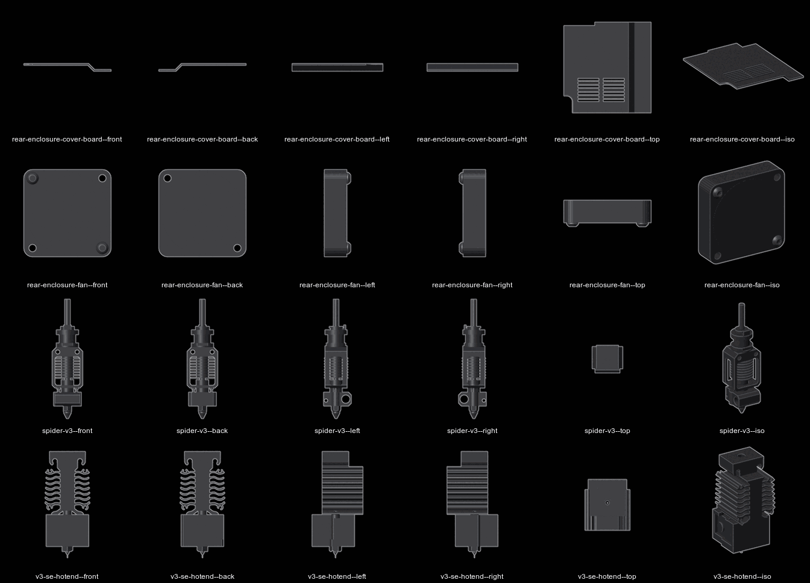

printer model

blender scene of the machine as built | mm | G28 park pose | fitted parts shown | unfitted parts parked, not deleted
positions come from cad and the stock model | nothing here is measured on the machine unless marked measured

previews


enclosure covers on in every tile except `rear--open` and the two plan tiles, `wiring--top` and `wiring--board`




every object colour black, set by the wiring script | viewports set to object colour | preview sheets draw the same on a black ground, edges lit, pale outline
real colour kept as a `Real rrggbb` material in the last slot of each part's data, from name rules | no face uses it | `Solder Black` first where a part had no material
real colours | black extrusions, plates, brackets, carriages, fasteners, printed parts, fans, rollers, belts, spool holder, glass | silver motor caps and shafts on black bodies | aluminium bed | silver lead screws, couplers and supply case | brass nut, gear and nozzle | red anodised extruder body and idler | green boards | white plugs | leads in conductor colour
hotend real colour from its own materials | parts sharing one mesh share one real colour

files

| Path | What |
|---|---|
| `~/Projects/Assets/blend/solder/Solder.blend` | this machine | 735 objects | blender 5.2 |
| `~/Projects/Assets/blend/solder/Ender-3.blend` | stock ender 3 | carriage at the corner | datum for every stock dimension below |
| `~/Reference/hardware/printer/blend/solder/` | one STL per mod, in the scene's world frame, so they line up as assembled |
| `~/Reference/hardware/printer/blend/ender-3/` | stock part STLs | corner pose |
| `~/Reference/hardware/printer/blend/blend.json` | index of both folders | hand-kept descriptions |
| `~/Reference/hardware/printer/v3-se-hotend/` | hotend STEP and per-part STLs | https://www.printables.com/model/969613-ender-3-v3-se-cad-hotend-assembly-mostly-stock | CC BY-SA |
| `~/Downloads/Save/models/solder/` | downloaded mod library by subsystem | `frame/Feet_v2.stl` is the fitted foot | `electronics/` holds the enclosure box and its vented covers |
| `~/Projects/Assets/cad/blendrefs.py` | scene to reference STLs |
| `../model-preview.py` | scene and STLs to preview tiles |

frame of reference

units mm | scene scale 0.001
`+X` printer left, x motor and stock z rod side | `-X` right | `+Y` front | `-Y` rear | `Z` up
`z 0` underside of the 4040 base rails | floor at `z -43.1` on the feet
x 0 mid-frame | nozzle x 1.48 at printer X 117.5

pose

G28 park from `config/printer.cfg` | `home_xy_position: 117.5, 117.5` | `z_hop: 10`
nozzle tip `(1.48, 55.53, 117.68)` | glass top `z 107.7` | clearance 10.0
glass `x -116.0..119.0` | `y -61.6..173.4` | 235 x 235 x 4 | heated bed under it `z 100.7..103.7`

moving the pose
- `20x20 X` is the z mover | carries `X carriage`, `X motor bracket`, the stock z nut
- `X carriage` is the x mover
- `Y carriage` is the y mover | carries bed and glass
- not parented, move by hand with the carriage: collections `Extruder` | `Direct Drive` | `V3 SE Hotend` | `Spider`
- not parented, move by hand with the x beam: `Z threaded rod nut.001` | `M3x10 1.001` | `M3x10 2.001` | `M3 washer 1.001`..`4.001`
- not parented, move by hand with the bed: loose objects in `Build Plate`

collections

| Collection | State | Holds |
|---|---|---|
| `Ender 3` | shown | stock machine | `Frame` | `Spool Holder` | `Z axis` | `X axis` | `Y axis` | `Power Supply` | `Board` |
| `Ender 3/Removed` | parked | stock parts off this machine | hotend, hotend cover, board lid and its fan, cables, LCD 12864, rubber feet |
| `Solder` | shown | every mod, fitted ones first |
| `Solder/Dual Z` | shown | second lead screw, `Dual Z Motor`, coupler, nut | `Z Rod Top Mount Left` and `Right` | `Z Rod Top Mount Cover Right` | `Z Splitter` |
| `Solder/Direct Drive` | shown | `Direct Drive Bracket` | `Fan Duct 5015` | `Cable Cap` | `Heatsink Fan` | `Part Blower` |
| `Solder/V3 SE Hotend` | shown | `V3SE heatsink` | `heater-block` | `sock` | `heater` | `nozzle` |
| `Solder/Rear Enclosure` | shown | `Enclosure Box Board` and `Aux` | `Enclosure Cover Board` and `Aux` | `Enclosure Fan Board` and `Aux` |
| `Solder/Screws` | shown | `Screw *` on the mods | the stock model's bolt meshes, `Bolt M3 16mm`, and `Bolt M3 8mm`, `14mm`, `18mm`, `Bolt M5 10mm` remixed from the nearest stock length with the shank rescaled |
| `Solder/Wiring` | shown | `Wire *` runs | `Lead *` hotend leads | `Loom Toolhead` | `Loom Bed` | `Zip Tie *` | `Plug USB` | the xh254 plugs each run lands on |
| `Solder/Feet` | shown | `Foot Front Left` | `Front Right` | `Rear Left` | `Rear Right` | one mesh |
| `Solder/Not Fitted` | parked | `Spider` | `Front PSU Mount` | `Boreas` | `Belted-Z` | `Feet_v2 short`, a 35.5 mm copy of the foot |
| `Build Plate` | shown | glass | `Print` holds three skull parts, print subjects, hidden in previews |
| `Floor` | shown | ground plane, hidden in previews |
| `* Booleans` | parked | modifier cutters |

naming
- left and right are the printer's own, seen from the front | left is `+X`
- enclosure parts are named by what they hold, `Board` at `+X` and `Aux` at `-X` | the source files name the halves from the rear, so their Left is `Aux`
- the vented cover files are named the other way round | `Cover_Left_..._For_Push` is `Enclosure Cover Board`
- a mesh keeps its source file name, the object carries the scene name
- green collection is this machine's mods | red is parked

parked means excluded from the view layer | `blendrefs.py` unhides everything, so parked parts still export

positions, park pose

| Part | min x y z | max x y z |
|---|---|---|
| x beam `20x20 X` | -180.5 17.2 154.4 | 164.5 37.2 174.4 |
| top beam `20x20 Top` | -165.0 -10.0 440.0 | 165.0 10.0 460.0 |
| `X carriage` | -14.1 20.5 132.7 | 49.9 47.9 196.8 |
| `Y carriage` | -95.0 -39.2 76.8 | 95.0 150.8 80.8 |
| `Direct Drive Bracket` | -18.8 22.2 175.6 | 49.9 70.8 244.1 |
| `Fan Duct 5015` | -41.9 43.7 128.2 | 41.6 94.7 206.7 |
| `Cable Cap` | -22.4 43.7 191.6 | -14.0 84.6 205.2 |
| `V3SE heatsink` | -11.4 48.2 142.1 | 14.1 71.2 177.7 |
| `V3SE heater-block`, with heatbreak neck | -8.7 44.4 126.1 | 11.3 64.4 153.0 |
| `V3SE sock` | -10.7 42.4 124.1 | 13.3 66.4 142.1 |
| `V3SE nozzle` | -1.7 52.2 117.7 | 4.3 59.1 134.7 |
| stock z nut | 139.0 -42.7 198.5 | 151.6 -18.7 209.0 |
| second z nut | -151.6 -42.7 198.5 | -139.0 -18.7 209.0 |
| psu case | 211.5 -121.0 -43.1 | 260.9 93.0 69.9 |
| spool holder frame | 113.1 -10.2 460.0 | 156.4 11.2 610.0 |
| `Enclosure Box Aux` | -165.0 -149.5 0.0 | 3.5 -14.5 40.0 |
| `Enclosure Box Board` | -11.5 -149.5 0.0 | 165.0 -14.5 40.0 |
| enclosure covers | -125.0 -149.5 29.0 | 125.0 -20.5 40.0 |
| `Enclosure Fan Board`, housing | 82.0 -159.8 0.0 | 122.0 -149.5 40.0 |
| `Enclosure Fan Aux`, housing | -122.0 -159.8 0.0 | -82.0 -149.5 40.0 |
| board | 7.0 -110.0 8.5 | 107.0 -40.0 28.5 |
| `Z Rod Top Mount Right`, second rod | -166.7 -46.3 448.0 | -123.3 -10.0 467.0 |
| `Z Rod Top Mount Left`, stock rod | 123.6 -46.3 448.0 | 167.0 -10.0 467.0 |
| foot, front left | 125.0 120.0 -43.1 | 165.0 140.0 5.5 |

hotend mount

V3 SE heatsink, block, heater and nozzle from the STEP | fitted heatbreak is the stock PTFE-lined one, see [`hotend.md`](hotend.md)
heatsink 25.4 x 23.0 x 35.6
two blind holes r 1.38 in the rear face | 14.18 apart | 5.41 below the heatsink top | 15 deep | centred on the nozzle axis
two vertical holes r 1.0, 14.11 apart, block to heatsink
bore r 2.1 for PTFE | counterbore r 3.0, 9.2 deep, for the heatbreak
block | heater bore r 2.95 | thermistor bore r 1.45 | 13.63 apart across the nozzle axis | both 15.39 above the tip
nozzle tip 54.63 below the hole axis
stock carriage heatsink screws | two M3 | 14.0 apart | 39.58 above the carriage plate bottom | pair centred 15.61 from its `-X` edge
placement | heatsink holes on those screws | rear face on the carriage plate | nozzle 7.5 forward of the plate
result | nozzle tip 7.49 below the stock tip | block body about 8.4..22.4 above the tip
block is at its CAD dimensions | confirmed against the machine
duct lowest point 10.5 above the tip | 2.1 above the block's bottom face | outlet on the block, not at the nozzle

feet

`Feet_v2.stl` | 40 x 20 x 48.6 | 920 triangles | taper 40 wide at the rail to about 20 at the floor
two T keys 5.5 tall, 20 apart, up into the two underside slots of a 4040 side rail
four, one per corner | centres `x ±145` `y ±130` | 5 mm in from the rail ends
frame 43.1 off the floor

rear enclosure

two-part box with magnet covers | https://www.thingiverse.com/thing:3969336 | vented covers are a remix of its covers
fills the rear bay between the 4040 side rails, behind the cross rail | 330 wide over the ears | 135 deep | 40 tall, level with the rails
each half ends in a 40 x 40 ear on the rear end face of a side rail, two screws | front tabs sit 5.5 into the cross rail slot
halves meet in an interlocking joint over `x -11.5..3.5`
`Enclosure Box Board` is `Rear_Enclosure_Right.STL` | `Enclosure Box Aux` is `Rear_Enclosure_Left_RevA.STL`, the modified half
as built, the aux half has no Pi standoffs and no Pi port face plate | the modified print file is not on disk, so the scene cuts the stock mesh
cuts | four standoffs at `x -24.4, -73.4` `y -119.4, -61.5` down to the floor | Pi port plate `x -80.5..-30.0`
port opening closed with plain wall, `y -147.5..-144.5` up to `z 37.5`, in line with the rear wall either side | 29 high over `x -34.5..-30` under the cover dip
box file frame | x width, y height, z depth from the rear face | placed with `x' = c - x`, `y' = z - 149.5`, `z' = y` | c 165 board, 99.2 aux

covers | 124 x 129 x 11 each | vented remix of the box's own covers, same outline, so they are the right pair for this box
seat | 2.5 plate lies on the wall tops at `z 37.5`, top face at 40 level with the rails | zero gap, no interference
rear edge on the fan boss plane `y -149.5` | 44 x 5 corner notch closes on the ear and boss block | front edge 0.5 short of the cross rail
placed on the magnets | four 2.1 deep pockets per cover over four in its box half, centres coincide
board half pockets `43.5 -135.5` `43.5 -29.0` `98.0 -29.0` `116.0 -132.5` | aux half `-43.5 -135.5` `-43.5 -29.0` `-106.0 -29.0` `-116.0 -132.5`
side edge against the rail's inner face `x 125`, over the 3 mm side wall top | notch at `x 81`, boss rim from 82
centre dips 8.5 under the y rail | covers end at `x 1.0` and `-1.0`, 2 mm apart

fans | 40 x 40 x 10, one on the rear boss of each half | boss 44 wide, face at `y -149.5`, 38 bore centred `x 102` and `-102`, `z 20`
fan housing stands outside the box, `y -159.8..-149.5` | two M3 screws through into the boss | airflow direction not recorded
mesh is the stock board lid fan | that fan and the lid are parked in `Ender 3/Removed`

board | on the four standoffs of the board half, tops at `z 8.5` | standoffs at `x 25.0, 87.0` `y -107.0` and `73.4 -69.3`, `105.2 -72.1`
stock board mesh turned half a turn about `56.8 -77.9` and lifted 3.5 to land its four holes on them

not placed | `RE_Back_Splice` | `RE_Front_Splice` | `RE_USB_Strain_Relief`

lead screw top mounts

dual screw rod kit, one per rod | block behind the top beam with a bearing plate over the screw end
block 43.4 x 36.3 x 14, `z 448..462` | plate 30 x 16 x 2 | footprint from the printed cover, height and position estimated | 8.8 bore from below to `z 460.5` clears the rod end | no CAD of the kit part on disk
printed cover | `Z Rod Top Mount Cover Right`, mesh `ender-3_pro_v2_dual_z-axis_stabilizer_cover` | 43.4 x 36.3 x 3.4 | https://www.printables.com/model/642829 | on the second rod's mount

other placements

- psu | CMS-350-24 mesh on its long edge on the floor left of the frame, z -43.1 | fan face toward the frame | terminal end to the rear | switch at x 200, clear of the leads on the side rail | exact spot is a placeholder
- second z rod | `x -149..-141` `y -34.7..-26.7`
- spool holder | left end of the top beam | its two M5 screws at `x 124.6` and `145.0` | frame bolts at `x 135` and `155`

reference STLs

`~/Reference/hardware/printer/blend/solder/` | size x y z in mm

| File | Size | Triangles | State |
|---|---|---|---|
| `v3-se-hotend.stl` | 25.4 28.7 60.0 | 94481 | fitted |
| `direct-drive-bracket.stl` | 68.7 48.5 68.5 | 6092 | fitted |
| `direct-drive-fan-duct.stl` | 83.5 51.0 78.5 | 27640 | fitted, real one is cut to clear the heatsink |
| `direct-drive-cable-cap.stl` | 8.4 40.9 13.7 | 36 | fitted |
| `dual-z.stl` | 333.7 57.1 426.9 | 57556 | fitted, both top mounts included |
| `dual-z-rod-mount.stl` | 43.4 36.3 19.0 | 228 | fitted, modelled from the cover footprint |
| `rear-enclosure-box-aux.stl` | 168.5 135.0 40.0 | 9240 | fitted, Pi standoffs cut, port opening walled |
| `rear-enclosure-box-board.stl` | 176.5 135.0 40.0 | 7858 | fitted |
| `rear-enclosure-cover-board.stl` | 124.0 129.0 11.0 | 2768 | fitted, `+X` |
| `rear-enclosure-cover-aux.stl` | 124.0 129.0 11.0 | 1676 | fitted, `-X` |
| `rear-enclosure-fan.stl` | 40.0 12.1 40.0 | 3612 | fitted, one of two |
| `feet-v2.stl` | 40.0 20.0 48.6 | 920 | fitted, one of four |
| `spider-v3.stl` | 22.0 20.0 86.0 | 14220 | off the machine |
| `psu-front-mount-left.stl` | 90.4 118.0 69.0 | 2856 | not fitted |
| `psu-front-mount-right.stl` | 22.4 117.0 64.8 | 696 | not fitted |
| `boreas-duct-5015.stl` | 85.2 54.8 100.3 | 58860 | not fitted |
| `boreas-clamp.stl` | 11.0 5.3 14.7 | 356 | not fitted |
| `boreas-bltouch-mount.stl` | 13.0 18.0 26.0 | 1772 | not fitted |
| `boreas-hotend-plate.stl` | 106.3 64.8 67.6 | 7618 | not fitted |
| `belted-z.stl` | 374.8 111.4 453.6 | 93044 | not fitted |

wiring

poly curves with a round bevel in `Solder/Wiring`, a point every 2 mm | one object per lead or loom | every lead black
no two runs overlap, 0.25 clear of each other | waypoints set the route, an untangle pass in the wiring script moves runs apart and off the solids, ends fixed
leads meet a loom side by side in its end plane, 8 mm of parallel run-in
every run ends 1 mm inside its plug | plugs are parented to the board sockets and the motor connectors, so they follow a moved board, the curves do not
every run enters by an opening that exists in the box meshes | each run ray-checked on its centreline and at its radius, clear apart from the plug, connector or bracket it ends on
no run crosses the inside of the frame | gantry runs lie on the frame's outer faces and under the base, where the zip ties go | supply pair under the base and along the floor

board sits on the box's five standoffs, the only rotation that seats all five holes | usb and sd on the edge at x 7, facing the centre, under the Y rail
usb socket y -87.7 to -79.7 | sd slot y -107.5 to -92.5 | screw terminals x 61 to 93 on the front edge | motor sockets on the rear edge | 2-pin sockets on the front edge

openings, read off the meshes

| Half | Face | Opening | Carries |
|---|---|---|---|
| board | front | x 72 to 108, z 5 to 17, behind the cross rail's milled pocket, x 76 to 116, open underneath | toolhead loom | X motor | X endstop | Z endstop | supply pair out |
| board | top | slot x 113 to 122, y -44.5 to -23.5, beside the left Z motor | left Z motor |
| board | top | front lip notch x 70 to 100, y -20.5 to -14.5, under the cross rail | nothing |
| board | rear | slot x 73 to 80, z 27 to 37, beside the fan | bed loom over Y motor |
| board | rear | square x 41 to 54, z 6 to 19 | usb |
| board | rear | fan opening x 82 to 122, z 3 to 37 | fan lead |
| centre | top | gap between the covers, x -1 to 1 | Y endstop, at y -128 behind the Y rail's end |
| aux | top | slot x -122 to -116, y -50.5 to -23.5, beside the right Z motor | right Z motor |
| aux | rear | hole x -30 to -22, z 9 to 27 | nothing |
| aux | rear | fan opening x -122 to -82, z 3 to 38 | fan lead |

left is x positive, the board half, seen from the front
inside the board half | fan partition x 80 to 82 runs y -148 to -116 | rib at y -64 from x 110 to the wall
lane between the board edge and that rib is the only way past it | left Z motor, X motor and bed heater stacked there at x 107.3, z 25.5, 20.5, 15.5
post under the centre gap at y -125 to -119 | rail covers the gap forward of y -120 | the Y endstop lead drops behind both

| Run | From | Into the box | Lands on |
|---|---|---|---|
| `Lead Heater` | heater cartridge, right end | joins `Loom Toolhead` behind the extruder | `Wire Heater` |
| `Lead Hotend Thermistor` | thermistor bore, right end of the block | same | `Wire Hotend Thermistor` |
| `Lead Heatsink Fan` | `Heatsink Fan`, top right corner | same | `Wire Heatsink Fan` |
| `Lead Part Fan` | `Part Blower`, top rear | same | `Wire Part Fan` |
| `Lead E Motor` | extruder motor plug | same | `Wire E Motor` |
| `Loom Toolhead` | behind the extruder, 58 18 262 | front opening | splits into `Wire E Motor`, `Wire Hotend Thermistor`, `Wire Part Fan`, `Wire Heatsink Fan`, `Wire Heater` |
| `Wire X Motor` | X motor plug | front opening | X socket |
| `Wire X Endstop` | X endstop plug | out the left side window of the endstop block, down outside the X motor plate, front opening | X endstop socket |
| `Wire Z Endstop` | Z endstop on the left upright, down the side rail's outer face | front opening | Z endstop socket |
| `Wire Z Motor Left` | left Z motor plug | board top slot | `Z Splitter` |
| `Wire Z Motor Right` | right Z motor connector | aux top slot, across the divider | `Z Splitter` |
| `Wire Z Splitter` | `Z Splitter` | inside the box | Z socket |
| `Wire Y Motor` | Y motor plug | rear slot | Y socket |
| `Loom Bed` | bed underside, looped behind the Y motor | rear slot | splits into `Wire Bed Thermistor`, `Wire Bed Heater` |
| `Wire Y Endstop` | Y endstop plug, back along the rail | centre gap | Y endstop socket |
| `Wire 24V +` and `-` | screw terminals | out by the front opening, down through the pocket, under the base at z -9.5 below the gantry leads, down to the floor left of the frame, rearward at x 189 to 193 between rail and supply, round its rear end and up its outer side to z 53 | supply terminal block |
| `Wire USB` | `Plug USB` in the board's socket | round the board's rear corner, out by the rear square | free end 50 mm behind the box |
| `Wire Enclosure Fan Board` and `Aux` | fan hubs | fan openings | board fan socket |

hotend leads | heater and thermistor leave the block's right end, pass under the duct's inner wall below z 150 into its cable slot, x -22 to -14 | heatsink fan lead runs back along the same slot under `Cable Cap`, 3 mm of height at y 70
all three leave the slot's open rear at z 187 to 190 | blower lead joins outside | up the bracket's right side at x -22 to -27 | across behind the extruder at y 16 to 20, z 260 | into the loom at x 58
stand-in parts, built by the wiring script, no source file | `Heatsink Fan` is the enclosure fan's `Fan 4010` mesh on the duct's front seat, which leans back 12.5 deg, centre 1.6 80.0 178.0, back face on the seat, its four holes on the duct's | blower carries one ear over the duct's hole at y 88.2, z 198.0 | `Part Blower` is a 51 x 51 x 15 scroll on the duct's right face, x -39.7 to -24.7, outlet down onto the duct inlet at y 72 to 92, 27.4 long | `Z Splitter` is a 22 x 10 x 7 block behind the board's rear edge at y -122, in line with the Z socket
screws, built by the wiring script at holes read off the meshes | head at the outer face, shank into the hole
| Screws | Size | Where |
|---|---|---|
| `Screw Heatsink Fan 1` to `4` | M3x14 | fan front face into the duct's 5 deep holes, 32 square, x -14.4 and 17.6 |
| `Screw Blower 1` | M3x18 | through the blower ear into the duct's right face, -24.4 88.2 198.0 |
| `Screw Duct 1` | M3x8 | duct counterbore into the bracket, -8.9 48.4 201.7 |
| `Screw Enclosure Fan Board` and `Aux`, `1` to `4` | M3x16 | fan corners into the rear wall, x 86 and 118 either side, z 4 and 36 |
| `Screw Enclosure Box Board` and `Aux`, `1` and `2` | M5x10 | rear wall into the side rails' tapped ends, x 155.5 z 30 and x 135.5 z 10 either side |
| `M3 Board.004` | M3x6 | board's fifth standoff, 9.2 -42.3, copy of `M3 Board` |
stock machine and the other mods keep the bolts their source models carry | lengths chosen to fit the holes, not read off the machine
gantry runs | toolhead loom leaves the extruder plug rearward, runs behind the X bar, the left upright and the Z lead screw, over the stock extruder bracket, round the X motor to the outside of the upright | X motor and X endstop leads join it there
`Zip Tie 1` and `2` round the left upright at z 107.5 and 103.5 hold the three to its outer face, between the gantry's lowest wheel and the Z endstop bracket | then out to x 178.5 past that bracket | down the side rail's outer face | under the base at z -2.5 to -4 | up through the pocket into the front opening
`Wire Heater`, `Wire Bed Heater` and the supply pair end in the terminal block's front face
radii | motor leads 1.6 | toolhead loom 2.4 | bed loom 3.0 | supply and bed heater 1.6 | usb 2.0 | heater and its lead 1.2 | endstops 0.8 to 1.0 | thermistors and fans 0.8

open

- psu spot on the floor is a placeholder | real position not recorded
- heatsink fixing | CAD shows two blind M3-size holes from the rear | [`printed-parts.md`](printed-parts.md) says one M4 screw | check on the machine
- duct mesh is the uncut one | heatsink 25.5 wide in a 21 opening, side plates 4.7 into the duct walls, rear shelf overlaps at y 66 to 71, z 150 to 156
- sock clips the carriage plate by 1.0
- `Direct Drive Bracket` sits 3.4 into the `X carriage` plate at y 41 to 43.5 | 1.6 into the duct at -9 45 196 | bracket position not measured
- enclosure fan spigots are 1.0 over their box windows, a press fit
- stock model overlaps left as imported | bed springs, belts on pulleys, X plate rollers, glass clips, supply internals
- board mesh is the V1.1.4, fitted board is the V4.2.7
- blower, heatsink fan and Z splitter are stand-ins | sizes nominal, positions read off the duct, not the machine | splitter form and position not recorded
- wiring routes are drawn, not measured | socket, terminal, usb and sd positions follow the V1.1.4 mesh
- `Plug USB` is a block | heatsink fan lead shares the board fan socket with both enclosure fans, no always-on header on the mesh
- runs are drawn at the G28 park pose | no slack loop for Z or Y travel
- zip ties modelled on the left upright only | none on the rails or under the base
- enclosure cuts are estimated from the stock mesh | Y motor plug notch in the board box and its cover, x 35.4 to 46.1, from y -140.3 back, z 34.9 up, is the plug's bounds plus 0.6 | aux half's real cut lines not recorded
- enclosure fan airflow direction not recorded | both fan leads on the board fan socket
- lead screw top mount is a block model | height, screw positions and its place on the frame not measured
- cover on the stock rod's mount not modelled | one cover on disk
- foot position along the rail is assumed

regenerate

```sh
B=/Applications/Blender-cad.app/Contents/MacOS/Blender
S=~/Projects/Assets/blend/solder/Solder.blend
R=~/Reference/hardware/printer/blend/solder
T=/tmp/tiles; mkdir -p $T

# reference STLs
$B -b --factory-startup $S -P ~/Projects/Assets/cad/blendrefs.py -- solder

# tiles, from devices/printer
$B -b --factory-startup $S -P model-preview.py -- scene $T
$B -b --factory-startup -P model-preview.py -- parts $T $R

# sheets
M=(montage -font /System/Library/Fonts/Supplemental/Arial.ttf -background '#000000' -fill white -label '%t')
$M $T/printer--{front,back,left,right,top,iso}.png -tile 3x2 -geometry 600x600+3+3 hardware/model/printer.png
$M $T/toolhead--{front,back,left,right,under,iso}.png -tile 3x2 -geometry 600x600+3+3 hardware/model/toolhead.png
$M $T/feet--{low,under,corner}.png -tile 3x1 -geometry 600x600+3+3 hardware/model/feet.png
$M $T/rear--{closed,open,fans,ztop}.png -tile 2x2 -geometry 600x600+3+3 hardware/model/rear.png
$M $T/wiring--{machine,front,gantry,upright,bottom,under,rear,top,board}.png -tile 3x3 -geometry 600x600+3+3 hardware/model/wiring.png
```

`parts-1.png` to `parts-3.png` are the same montage at `-tile 6x -geometry 220x220+2+2`, eight parts a sheet, six views a row
`magick f.png -colors 96 -strip PNG8:f.png` keeps each sheet near 100 KB
