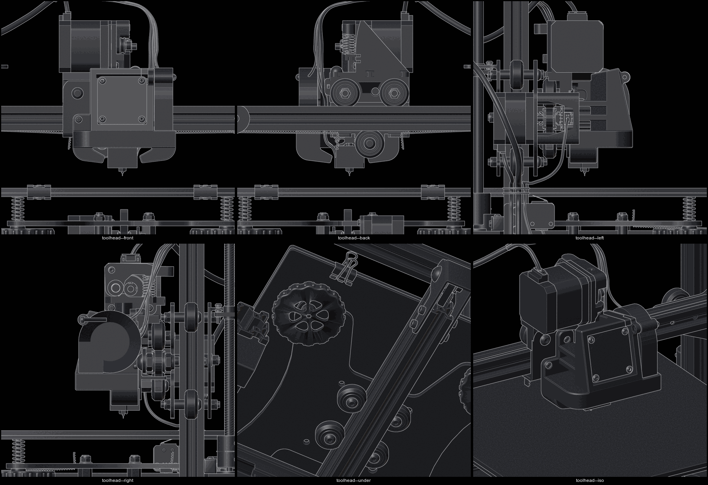
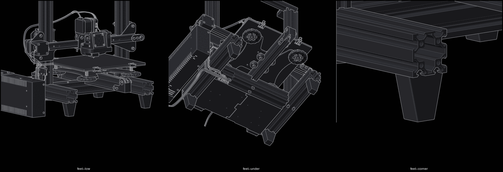
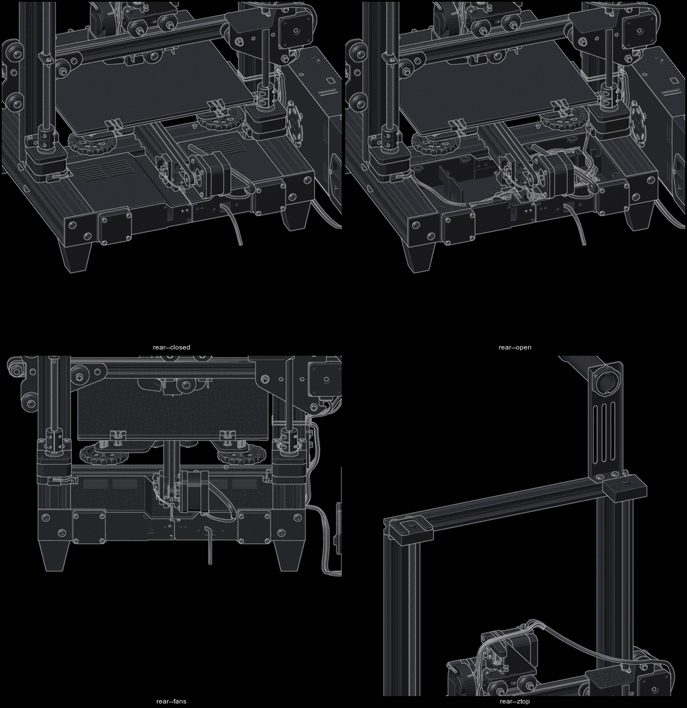

printed parts and source models

Every printed mod this machine depends on, and where the model came from. Fields
marked **TODO** are things only the person who printed them knows — fill them in
rather than guessing, because reprinting a mystery part after a crash is how a
rebuild stalls.

in use

direct drive bracket

| | |
|---|---|
| Function | Carries the stock extruder + stock NEMA17 on the X gantry |
| Source model | **TODO** — confirm which model was printed. Mesh as fitted: `~/Reference/hardware/printer/blend/solder/direct-drive-bracket.stl` |
| Licence | TODO |
| Material / settings | TODO |
| Status | Fitted, load-bearing |

Candidate, file not on disk: `BMG DirectDrive Adapter Ender 3 Pro
- remix from scaryPug's design - 4932302.zip`. That adapter is designed around a **BMG**
extruder, and this machine uses the **stock** extruder, so it is probably *not*
the part in use. Confirm before relying on it.

Anything this bracket changes — nozzle X/Y offset, carriage mass, Z clearance —
is currently unmeasured. See [`calibration.md`](../setup/calibration.md).

satsana fan duct (5015)

| | |
|---|---|
| Function | Part cooling, 5015 blower, replaces the stock 4015 duct |
| Source model | Satsana Ender 3 cooling duct — **TODO** confirm exact variant / remix / thing ID |
| Licence | TODO |
| Blower | 5015, 24 V |
| Status | Fitted |

**This part is the blocker for auto bed levelling.** The variant in use has no
BLTouch mount, and a 3D Touch sensor is sitting unused in the parts box. Fixing
it needs a Satsana remix that carries a probe boss, printed on this machine —
so the first prints happen on a manual mesh, and the probe goes on after.

**The fitted duct is modified to clear the Ender-3 V3 SE hotend, and its outlet
rests on the heater block instead of pointing at the nozzle tip.** It touches
hot metal and cools the block rather than the plastic; consequences are in
[`hotend.md`](hotend.md). The next duct has to fix the outlet height as well as
carry the probe.

Satsana variants exist for: stock hotend vs all-metal, 4010 vs 5015 blower, with
and without BLTouch, and with and without a dual-blower option. None is drawn
for the V3 SE block, so the remix has to match **V3 SE hotend + 5015 +
BLTouch**; record the choice here.

duct for the v3 se hotend — candidates

No published model puts a V3 SE hotend on the stock Ender 3 carriage. The V3 SE
heatsink is a 25 × 13 × 35 mm block held by one M4 screw; every Ender 3 carriage
duct is drawn around the MK8 heatsink and its two M3 screws. So the part is a
remix of the fitted duct, built against reference CAD.

| Model | Mounts to | Use |
|---|---|---|
| Fitted duct and bracket, `~/Reference/hardware/printer/blend/solder/direct-drive-fan-duct.stl`, `direct-drive-bracket.stl` | this carriage, this direct drive | **remix base** — mounting already fits, only the outlet is wrong |
| V3 SE hotend assembly CAD, https://www.printables.com/model/969613-ender-3-v3-se-cad-hotend-assembly-mostly-stock | reference | block, heatsink and nozzle geometry to aim the outlet at |
| V3 SE gantry plate and carriage reference, https://www.thingiverse.com/thing:6834478 | reference | V3 SE side of the geometry |
| Ender 3 X-carriage with hotend CAD, https://www.printables.com/model/560756-ender-3-standard-x-carriage-incl-hotend | reference | stock carriage hole positions |
| Satsana 5015, https://www.printables.com/model/467942-satsana-5015-fan-duct-for-ender-3-cr-10 | Ender 3 carriage, MK8 heatsink | outlet shape to copy; does not fit the V3 SE block as drawn |
| Tiki3, https://github.com/yduf/Tiki3 | Ender 3 carriage | STEP files, dual 5015, direct drive only with an Orbiter V1.5 — not the stock extruder |
| V3 SE adjustable 5015 shroud, https://www.printables.com/model/1263394-ender-3-v3-se-adjustable-5015-fan-shroud | V3 SE toolhead | 8 mm vertical slot idea worth copying; will not bolt to this carriage |
| V3 SE dual 5015 ducts, https://www.printables.com/model/814210-ender-3-v3-se-5015-blower-fan-ducts | V3 SE toolhead | outlet geometry around the V3 SE block; will not bolt to this carriage |

Measurements the remix needs, taken on the machine with the hotend cold:
nozzle tip to underside of the heater block, duct outlet lip to nozzle tip in Z,
and outlet centre to nozzle centre in X and Y.

feet

| | |
|---|---|
| Function | Riser foot, lifts the frame 43.1 mm off the floor |
| Source model | `Feet_v2.stl`, 40 × 20 × 48.6 mm. Mesh as fitted: `~/Reference/hardware/printer/blend/solder/feet-v2.stl` |
| Mounting | Two T keys slide into the two underside slots of a 4040 base rail, no screws |
| Count | 4, one per corner |
| Licence | TODO |
| Material / settings | TODO |
| Status | Fitted |

Position in the model and previews: [`model.md`](model.md).

dual z

| | |
|---|---|
| Kit | dual screw rod upgrade kit, ×2 |
| Top mounts | One per rod, behind the top beam, bearing plate over the screw end. Kit part, not printed |
| Printed cover | `ender-3_pro_v2_dual_z-axis_stabilizer_cover.stl`, 43.4 × 36.3 × 3.4 mm, <https://www.printables.com/model/642829> |
| Printed parts needed | TODO — the rod connector printed for it is not on disk |
| Status | Fitted, both motors on one driver |

rear electronics enclosure

| | |
|---|---|
| Function | Two-part box in the rear bay of the base, holds the board and wiring |
| Source model | `Rear_Enclosure_Left_RevA.STL`, `Rear_Enclosure_Right.STL`, <https://www.thingiverse.com/thing:3969336> |
| Size | 330 wide over the ears, 135 deep, 40 tall. Left half 168.5 wide, right half 176.5 |
| Covers | Vented remix of the same model's covers, 124 × 129 × 11 mm each |
| Fans | Two 40 × 40 × 10, one on the rear boss of each half, outside the box |
| Mounting | A 40 × 40 ear on the rear end of each 4040 side rail, two screws each. Front tabs in the cross rail slot |
| As built | Left half printed without the Pi standoffs and with plain rear wall where the Pi port face plate was. That print file is not on disk |
| Material / settings | TODO |
| Status | Fitted |

Meshes as fitted: `~/Reference/hardware/printer/blend/solder/rear-enclosure-box-{board,aux}.stl` and `rear-enclosure-cover-{board,aux}.stl`.

local mod library

Not on disk. Nothing is fitted unless listed above.

| Zip | Relevance |
|---|---|
| BMG DirectDrive Adapter Ender 3 Pro (4932302) | Direct drive, but BMG-specific — probably not the fitted part |
| Boreas — Mosquito/E3D V6 Hotend Mount (4096159) | Alternative hotend mount, not in use |
| the vendor Sprite Extruder — Vulture V1 Toolhead (7080838) | Alternative toolhead, not in use |
| E3NS — Ender 3 V2 Neo Hotend using Ender 5 S1 Parts (7306857) | Not in use |
| Ender 3 Z Stent, Gantry Alignment Improvement (5241659) | **Relevant** — dual Z has no `z_tilt`, so gantry alignment is manual |
| Gantry Rod Support Bracket (7067770) | Frame stiffening, not fitted |
| Bearing Spool Holder for 2020/2040/3030 (2537713) | Not fitted |
| Ender 3 V2 Minimalist Bed Handle (4723754) | Not fitted |
| Ender 3 V3 KE/SE Filament Sensor Mount (6509336) | Wrong printer generation |
| Extruder Knob one-piece (3458220) | Cosmetic |

to print, in order

1. **Satsana remix with BLTouch mount** — unblocks the 3D Touch sensor, which
   unblocks `bed_mesh` automation, `safe_z_home` and `screws_tilt_adjust`.
2. **Filament runout sensor mount** — the runout kit is on hand and `PA4` is
   already stubbed in config.
3. Gantry alignment aid — dual Z with a single driver cannot self-level.

recording rule

When a printed part goes on this machine, add it above with: what it does, the
source model and where it came from, the licence, material and print settings,
and whether anything in `printer.cfg` depends on it. A printed part that changes
the nozzle position is a **config dependency**, not just a piece of plastic.
